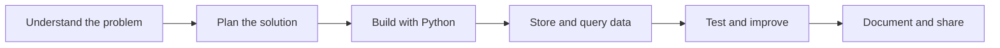

<!--
  SHIVANK SINGH — GitHub Profile README
  Save this file as README.md in:
  https://github.com/shivanksingh2904-ctrl/shivanksingh2904-ctrl

  This is a single-file README: images are remotely hosted, so no assets folder is required.
  GitHub README files do not run custom JavaScript; supported interactions include links,
  badges, collapsible sections, and Mermaid diagrams.
-->

  

  

  

    
    
    
  

  

---

## 👋 About Me

I'm a Computer Science and Engineering graduate (B.Tech, 2022–2026) focused on Python development, backend fundamentals, databases, and practical software projects.

- 🐍 **Focus:** Python, SQL, REST APIs, and FastAPI
- 🧠 **Currently improving:** coding logic, problem-solving, and SQL
- 🛠️ **Build style:** practical projects that solve everyday problems
- 🎯 **Career goal:** Python Developer / Software Development Engineer
- 🤝 **Open to:** entry-level opportunities, collaboration, and learning from developers

## 🧰 Tech Stack

  

  

    
    
    
    
    
  

## 🚀 Featured Projects

<table>
  <tr>
    <td width="50%" valign="top">
      <h3>🥬 PantryPulse</h3>
      
Track household food items, use-by dates, and value at risk. Prioritize what to use next and discover recipe ideas for food nearing expiry.

      

        
      

      
Focus: Python · Streamlit · Data-driven problem solving

    </td>
    <td width="50%" valign="top">
      <h3>📄 DocuMind</h3>
      
A document-focused project. Try the live app to explore the current deployment.

      

        
      

      
Open the deployed Streamlit app.

    </td>
  </tr>
  <tr>
    <td width="50%" valign="top">
      <h3>🔌 REST API Data Management System</h3>
      
A Python project focused on managing data through REST API concepts, JSON, and database integration.

      
<a href="https://github.com/shivanksingh2904-ctrl?tab=repositories">Browse repositories →</a>

    </td>
    <td width="50%" valign="top">
      <h3>👥 Employee Management System</h3>
      
A CRUD-oriented application for creating, searching, updating, and deleting employee records, with input validation.

      
<a href="https://github.com/shivanksingh2904-ctrl?tab=repositories">Browse repositories →</a>

    </td>
  </tr>
</table>

## 💼 Experience

  
<strong>Artificial Intelligence Intern — Codec Technologies</strong> · Online · Jun 2025 – Jul 2025

  - Worked on project-based AI learning and practical tasks.
  - Explored machine-learning techniques and research approaches.
  - Practiced data preprocessing and model evaluation.
  - Gained exposure to AI deployment tasks under industry mentorship.

  
<strong>Data Analyst Intern — Geeks of Gurukul</strong>

  - Use this section to highlight the data analysis work, tools, and project outcomes completed during the internship.
  - Add specific tools, datasets, dashboards, or measurable results only when you can verify them.

  
<strong>Web Development Intern — CodeAlpha</strong>

  - Practiced building responsive websites with HTML, CSS, and JavaScript.
  - Worked on portfolio and landing-page style projects and a basic CRUD application.
  - Used Git and GitHub to manage project work.

## 📊 GitHub Overview

  
  

   

  

   

  

> Note: GitHub statistics and activity cards are provided by third-party services. They may load slowly, be rate-limited, or be temporarily unavailable. Your GitHub profile and repositories remain accessible if a card fails.

## 🧭 How I Build

## 🎓 Education

**B.Tech — Computer Science and Engineering**  
2022–2026
CGPA - 7.55

## 📫 Connect With Me

  
  
  

    

  

