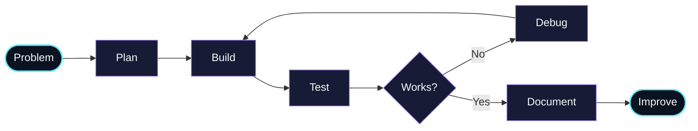

<h1>Hey, I'm Shivank Singh 👋</h1>

<b>Python Developer · Aspiring Software Engineer · AI & Backend Enthusiast</b>

  <a href="https://github.com/shivanksingh2904-ctrl?tab=repositories">⌘ Explore Projects</a>
  &nbsp;·&nbsp;
  <a href="https://linkedin.com/in/shivank-singh-79ab10256">↗ LinkedIn</a>
  &nbsp;·&nbsp;
  <a href="mailto:shivanksingh2904@gmail.com">✉ Contact Me</a>

---

## `01 / About me`

I'm a Computer Science and Engineering graduate (B.Tech, 2022–2026) who enjoys building useful applications with Python, SQL, APIs, and AI tools. I focus on learning fundamentals properly and turning ideas into working projects.

| 🐍 Main focus | ⚙️ Building with | 🎯 Current goal |
|:---:|:---:|:---:|
| Python + SQL | APIs, data apps, AI | Software Engineer |

<b>More about my technical interests</b>

- Python problem-solving, clean code, and debugging
- SQL queries, relational data, and CRUD operations
- FastAPI and REST API fundamentals
- Data processing with Pandas and Streamlit applications
- AI/ML and GenAI-powered project ideas
- Git, GitHub, documentation, and deployment basics

## `02 / Developer dashboard`

> The activity chart is generated from GitHub's public events feed and updates through GitHub Actions. Public events are not a complete count of all contribution activity.

## `03 / Featured builds`

<table>
<tr>
<td width="50%" valign="top">

<h3>🥫 PantryPulse</h3>

**Waste less food. Save more money.**

A Streamlit app for tracking food items, prices, and use-by dates, prioritizing what to use next, estimating value at risk, and suggesting recipes for items nearing expiry.

<b>Stack</b> Python · Streamlit · Data handling

<a href="https://pantrypulse-tlaaavgqpk89yx33zelxh4.streamlit.app/"><b>↗ Open live app</b></a> 
<a href="https://github.com/shivanksingh2904-ctrl?tab=repositories">Browse source repositories ↗</a>

</td>
<td width="50%" valign="top">

<h3>🧠 DocuMind</h3>

**Document-focused AI project**

A place for my document/AI project work. Browse my repositories for the current implementation, source files, and setup instructions.

<b>Focus</b> Python · AI concepts · Information retrieval

<a href="https://github.com/shivanksingh2904-ctrl?tab=repositories"><b>↗ Explore repositories</b></a>

</td>
</tr>
<tr>
<td width="50%" valign="top">

<h3>🔌 REST API Data Management</h3>

A Python project focused on structured data handling and CRUD-style API workflows.

<b>Stack</b> Python · REST API · JSON · MySQL

</td>
<td width="50%" valign="top">

<h3>👥 Employee Management System</h3>

A CRUD application to add, search, update, and delete employee records with input validation.

<b>Stack</b> Python · MySQL

</td>
</tr>
</table>

<b>🧭 My project workflow — expand</b>

## `04 / Tech stack`

| Area | Skills |
|---|---|
| Programming | Python, C++ fundamentals |
| Databases | SQL, MySQL, CRUD |
| Backend | REST APIs, FastAPI fundamentals |
| Data & AI | Pandas, Streamlit, AI/ML fundamentals |
| Web | HTML, CSS, JavaScript fundamentals |
| Tools | Git, GitHub, VS Code |

## `05 / Learning in public`

<b>My current roadmap</b>

- [ ] Practice Python lists, loops, conditions, functions, and dictionaries
- [ ] Improve SQL with joins, GROUP BY, and subqueries
- [ ] Build and test APIs using FastAPI
- [ ] Improve debugging, validation, and edge-case handling
- [ ] Learn Linux commands, logging, and deployment
- [ ] Keep each project README complete and reproducible

## `06 / Contribution animation`

The snake animation is generated by the included GitHub Actions workflow. It appears once the workflow has run and published the `output` branch.

  

## `07 / Connect`

<i>Thanks for stopping by — let's build something useful.</i>

